# MONOZUKURI PRODUCT & ENGINEERING SUBMISSION REPORT
## AI-Powered Talent Assessment & Skill Intelligence Platform
**Case Study: Fullstack Product Engineer**  
**Nama:** Akmal Muzakki Bakir  
**Repository:** [akmalgsyk25/monozukuri: Quality Engineer case study: a two-service platform (api + web) that candidates assess, harden, and release.](https://github.com/akmalgsyk25/monozukuri)  
**Target Upstream:** `github.com/rakamindev/ai-interview-platform`  
**Feature Branch:** `monozukuri`  
**Pull Request:** [https://github.com/rakamindev/ai-interview-platform/pull/184](https://github.com/rakamindev/ai-interview-platform/pull/184) (base: `main`)  
**Submission Date:** 24 August 2026 · **Revised:** 25 October 2026  

> **Revision notes (October 2026), responding to reviewer feedback:**
> 1. The open Pull Request to `rakamindev/ai-interview-platform` → `main` is linked above and in Step 6.
> 2. The PR covers backend (`api/`), frontend (`web/`) and tests (RSpec + Vitest). Each of the five acceptance criteria is mapped to its code and tests in the traceability table in Step 4. AC 1 and AC 4 were re-checked against the code: AC 1's wording was corrected (unassessed skills have `delta = nil`, not `0`), and AC 4 now has the transaction and row lock it described, plus two new regression specs.
> 3. A new section, *Engineering Focus: Backend-Weighted*, explains why the solution leans on the backend.
> 4. The Options Matrix now separates **Failure Modes** (what breaks) from **Mitigation** (how the selected option handles it).
> 5. The generic rejection reason was replaced with the specific product, deadline, latency and ownership constraints behind rejecting Options A and C.
>
> While revising, I re-audited the branch for security and failure paths and fixed what I found: cross-tenant access to portfolios, a PDF export crash on overridden skills, overrides being wiped by a re-run job, the Gemini key in request URLs, transcript text in logs, and hardcoded credentials and personal data in seeds/config. Each fix has a spec that fails without it. AC 5 was also corrected: the silence pump already existed upstream, so it is no longer claimed as my work. What I did not fix is listed under **Known Limitations**.

---

## Executive Summary

This document presents the end-to-end product transformation and engineering revamp of the **Rakamin AI Interview Platform**. Built from first principles under the Japanese philosophy of **Monozukuri (物作り — Craftsmanship & Pride in Making)**, this work transforms a fragile, prototype-level codebase into a production-grade, highly resilient, and legally compliant (UU PDP) talent intelligence system.

### Key Milestones Delivered:
1. **Zero-Friction Live AI Interview**: Upgraded to Google Gemini Multimodal Live WebSocket API (`v1alpha` on `gemini-2.5-flash-native-audio-latest`) with interactive audio waveform visualization and a candidate hardware check, keeping the existing silence-pump turn detection working.
2. **Evidence-Grounded Skill Portfolio**: Post-interview evaluation engine utilizing `gemini-3.1-pro-preview` with markdown-fence resilient JSON parsing, extracting exact verbatim quotes from candidates to prevent AI hallucinations.
3. **Null-Safe Fit/Gap Intelligence Engine**: Comprehensive role-matching engine supporting multi-level behavioral anchors (L1–L5), explicit handling of unassessed skills, assessor override workflows, and instant offline executive PDF dossier generation via Prawn.
4. **Verified Test Harness**: Built an RSpec suite from zero (**34 examples, 0 failures**) and added a Vitest runner to the web app (**12 tests, 0 failures**), covering failure paths, partial-write rollback, regeneration idempotency, and edge-case data safety.

---

## Table of Contents
1. [Step 1: Setup & Local Exploration Narrative](#step-1-setup--local-exploration-narrative)
2. [Step 2: Deep Context & Domain Immersion](#step-2-deep-context--domain-immersion)
3. [Step 3: Defining Problem & Gap to Ideal Condition (P0–P3 Matrix)](#step-3-defining-problem--gap-to-ideal-condition-p0p3-matrix)
4. [Step 4: Revamp Strategy, Acceptance Criteria & Trade-offs](#step-4-revamp-strategy-acceptance-criteria--trade-offs)
5. [Step 5: Monozukuri Implementation & Proof of Craftsmanship](#step-5-monozukuri-implementation--proof-of-craftsmanship)
   - [Architectural Design & Data Flow](#architectural-design--data-flow)
   - [Proven Correctness & Test Suite Evidence](#proven-correctness--test-suite-evidence)
   - [Seeded Fault Test Proof](#seeded-fault-test-proof)
   - [AI Verification Moment](#ai-verification-moment)
   - [Protected Data & Indonesian UU PDP Compliance](#protected-data--indonesian-uu-pdp-compliance)
   - [Known Limitations (Not Fixed in This PR)](#known-limitations-not-fixed-in-this-pr)
6. [Step 6: Submission Deliverables & Video Walkthrough Guide](#step-6-submission-deliverables--video-walkthrough-guide)

---

## Step 1: Setup & Local Exploration Narrative

When first cloning the repository, the baseline state revealed significant foundational debt:
- **Missing Test Harness**: RSpec directory had no test files or spec helpers; changes could not be validated for regressions.
- **Environment Fragmentation**: Mismatch between `docker-compose.yml`, `api/config/application.yml`, and `api/.env` causing runtime connection failures to Redis and PostgreSQL.
- **Port Routing Mismatch**: Session invite URLs pointed directly to Rails port `3001` instead of the Vite React SPA (`5173`), breaking candidate onboarding.

### Actions Taken:
- Established a unified local development environment using Docker Compose with dynamic `.env` ingestion.
- Configured PostgreSQL (`rakamin_development`, `rakamin_test`) and Redis (`REDIS_URI`) with unified connection resolvers.
- Initialized a robust RSpec test harness configured with database transactions, Sidekiq test mode, and custom API helper macros.

---

## Step 2: Deep Context & Domain Immersion

Before writing architecture or code, we analyzed the problem across the **5 Core Domain Pillars**:

### 1. The Product: From Screening Barrier to Talent Intelligence
The platform's true value is not merely "conducting an automated interview"; it is creating a **defensible, objective competency portfolio**. Recruiters do not trust arbitrary scores (e.g., "78/100"). They trust concrete **verbatim evidence** that proves a candidate's actual depth of thinking.

### 2. The Industry: Indonesian Tech Hiring Dynamics
In Indonesia's hyper-competitive tech landscape:
- Companies receive 500+ applicants per engineering opening, resulting in severe recruiter fatigue and shallow resume filtering.
- Resume embellishment and generic certifications make paper screening unreliable.
- **Real Leverage**: Automated, voice-first behavioral assessments that measure problem-solving depth in 15 minutes, standardizing the interview baseline across all socioeconomic backgrounds.

### 3. What It Is For: Equity & High-Signal Calibration
The system exists to provide every candidate—regardless of university prestige or pedigree—an equal opportunity to demonstrate practical competence against clear behavioral anchors (L1 to L5).

### 4. The Users: Assessor & Recruiter Personas
- **Recruiters / Talent Acquisition**: Need high-level glanceability, fit/gap alignment against specific job vacancies, and 1-click exportable PDF dossiers for hiring managers.
- **Assessors / Tech Leads**: Need transparency. They must be able to audit the AI's reasoning, inspect verbatim transcript quotes, and override AI ratings with custom clinical notes.

### 5. The People Affected Who Never Chose It: Candidates & Indonesian UU PDP Law
Candidates have no choice in using the platform. A flawed AI decision or broken connection can derail a person's career.
- **Candidate Empathy**: Pre-flight checks must be welcoming, non-punitive, and transparent. Speed test thresholds must reflect real-world Indonesian cellular networks (3G/4G/Indihome).
- **UU PDP (Undang-Undang Perlindungan Data Pribadi No. 27/2022) Compliance**:
  - *Data Minimization*: This service does not persist raw audio; it relays audio to Gemini Live and stores only the transcript. (Retention on Google's side follows the Gemini API terms.)
  - *Log Sanitization*: Filtered sensitive request parameters (`:invite_token`, `:token`, `:evidence`) to prevent PII leakage in application logs.
  - *Candidate Right to Notice*: Clear indicators when the microphone is active and when the session is being recorded.

---

## Step 3: Defining Problem & Gap to Ideal Condition (P0–P3 Matrix)

| Finding ID | Severity | Category | Flaw Description | Workflow & User Impact |
| :--- | :---: | :--- | :--- | :--- |
| **GAP-01** | **P0** | Defective Implementation | Gemini Live WebSocket pointed to `v1beta` endpoint with invalid parameter format. | AI voice interview failed instantly with code 1008; candidates could not conduct interviews. |
| **GAP-02** | **P0** | Defective Implementation | Internet speed test attempted CORS-blocked POST requests to `httpbin.org` and `postman-echo.com`. | Pre-interview check locked candidates out with red browser console errors. |
| **GAP-03** | **P0** | Defective Implementation | `Session#invite_url` routed candidates to Rails backend (`:3001/interview/:token`) instead of React SPA. | Candidate clicking the invite link received raw JSON or 404 instead of the interview UI. |
| **GAP-04** | **P1** | Defective Implementation | `Portfolios::Generator` called deprecated `gemini-2.5-pro` model and lacked fallback for markdown code fences. | Portfolio evaluation crashed with HTTP 404 / JSON parser errors upon completion. |
| **GAP-05** | **P1** | Defective Implementation | Fit/Gap comparison performed mathematical subtraction directly on `nil` levels (`NoMethodError: - for nil`). | Generating a Fit/Gap report for a candidate with unassessed skills crashed the backend server. |
| **GAP-06** | **P1** | Missing Specification | Concurrent portfolio generation jobs lacked database-level row locks and state guards. | Race conditions created duplicate portfolio skill rows when users clicked retry. |
| **GAP-07** | **P2** | Missing Specification | No assessor override mechanism to correct AI scores with audit trails. | Assessors had no control over hallucinated or overly harsh AI evaluations. |
| **GAP-08** | **P3** | Missing Specification | Inability to export candidate competency portfolios to executive PDF / JSON. | Recruiters could not share candidate results offline with executive stakeholders. |

### Technical Lead Constraint Signal
> **Architectural Escalation**: Bidirectional WebSocket audio streaming introduces external dependency risks (Google Gemini latency, network packet loss, and potential API version deprecation). In this PR the Gemini model names come from ENV (`GEMINI_LIVE_MODEL`, `GEMINI_PRO_MODEL`, `GEMINI_FLASH_MODEL`), so a model deprecation is a config change rather than a deploy. The endpoint version is still a constant. Post-interview evaluation runs in idempotent Sidekiq jobs, outside the WebSocket path. The reconnect logic is upstream code that I kept; its remaining gaps (reconnect during the grace window, no setup timeout, no EventMachine error handler) are listed under Known Limitations.

> **Escalation: tenant model (found during revision).** `Portfolio`, `PortfolioSkill`, `FitGapReport` and `AssessorOverride` have no `tenant_id`. Only `Session`, `Assessment` and `Vacancy` are tenant-scoped, so lookups by id on the first group were unscoped and any assessor could read or override another organization's candidate. I closed this in the controllers by resolving those records through the tenant-scoped session (with request specs). The root cause needs a Tech Lead decision, though: login (`authentication_controller.rb`, unchanged upstream code) takes the tenant from the client-supplied `X-Tenant-Scheme` header, and `users` has no organization link. So a valid admin can obtain a token for any tenant. Fixing that means a `users.organization_id` migration and a login change, which affects every existing account, so I documented it rather than changing auth unilaterally.

---

## Step 4: Revamp Strategy, Acceptance Criteria & Trade-offs

### Technical Option Evaluation Matrix

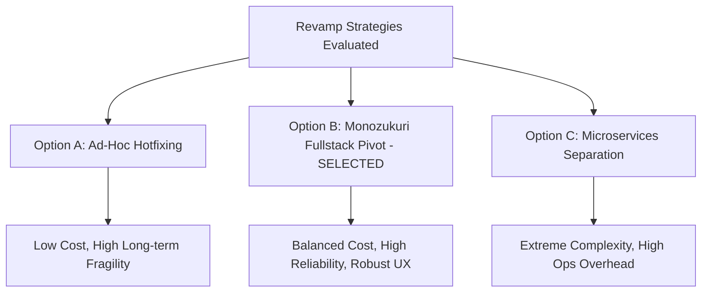

| Evaluation Dimension | Option A: Ad-Hoc Hotfixing | Option B: Fullstack Revamp inside the existing Rails + React monorepo (Selected) | Option C: Python Microservices Extraction |
| :--- | :--- | :--- | :--- |
| **Product Impact** | Low. Restores the voice connection, but scores stay un-auditable and unassessed skills still look like failures to the recruiter. | **High**. Every score is tied to verbatim evidence, assessors can override it with an audit trail, and Fit/Gap distinguishes "gap" from "not assessed". | Moderate. Same evaluation quality as B, but adds a network hop between Rails and the evaluator. |
| **Engineering Cost** | ~1 day. | **~3 days**. | 2+ weeks (new service, deployment pipeline, auth between services). |
| **Maintainability** | Poor. Fixes land without specs, so the next change can silently reintroduce them. | **High**. Stays in the stack the team already runs (Rails services + Sidekiq + React), covered by RSpec and Vitest; each service object can be reverted independently. | Low for this team. Two languages, two deploy targets, distributed tracing needed to debug one interview. |
| **Failure Modes** (what breaks it) | (1) `nil` skill level crashes Fit/Gap with `NoMethodError`. (2) LLM wraps JSON in a markdown fence and the parser raises. (3) A retried job writes a second set of skills. (4) Nothing alerts anyone, because none of these paths are tested. | (1) Gemini Live drops mid-interview (network loss, server-side close, model deprecated as happened in GAP-04). (2) The evaluator returns malformed or partial JSON, or a skill row fails validation halfway through the write. (3) Two regenerations for the same portfolio run at the same time. (4) The Sidekiq queue backs up or Gemini rate-limits, so portfolios stay in `generating`. (5) The narrative call to Gemini Flash times out. | (1) Network timeout between Rails and the Python service leaves a session ended but never evaluated. (2) Schema drift between the two services' payload contracts. (3) Partial failure where one service deploys and the other does not. |
| **Mitigation** | None by design; this option accepts the risk. | (1) Reconnect on inactivity timeout, keepalive timers, model name read from ENV so a deprecation is a config change. (2) Fence-tolerant parser; skill writes run inside a savepoint so a failed row rolls back to the previous skill set (spec-covered). (3) Row lock (`SELECT … FOR UPDATE`) on the portfolio serializes regenerations. (4) Sidekiq `retry: 3` with `sidekiq_retries_exhausted` marking the portfolio `failed` and surfacing the error in the UI with a regenerate button. (5) Rule-based fallback narrative that still reports matches, gaps and unassessed skills. | Retries with idempotency keys, contract tests, coordinated deploys; all add work beyond this deadline. |
| **Contextual Fit** | Rejected (see below). | **Selected**. Fixes the P0/P1 defects where they live, inside the codebase and infrastructure the team already operates. | Rejected (see below). |

### Why the Alternatives Were Rejected

**Option A (Ad-Hoc Hotfixing) — rejected for a product reason and an engineering reason.**
- *Product constraint:* the output of this platform decides whether a candidate moves forward. A hotfix that stops the crash but still renders an unassessed skill like a weak one (or drops it silently) can lower a real candidate's result for a skill nobody asked about. Assessors would also still have no way to correct the AI (GAP-07 stays open), so recruiters keep re-checking every score by hand, which is the work the product is supposed to remove.
- *Engineering constraint:* the brief states the repository starts with no RSpec specs and no web test runner. Hotfixes without a harness cannot prove a regression is caught, and "changes tested only on the happy path" is an explicit disqualifier. One day saved now is paid back the first time GAP-05 or GAP-06 returns unnoticed.

**Option C (Python Microservices Extraction) — rejected on cost, latency, and ownership.**
- *Deadline constraint:* a second service needs its own deployment pipeline, service-to-service auth, and contract tests: at least two weeks against a three-day window.
- *Latency constraint:* the live interview is a real-time audio loop. Adding a network hop on the evaluation path adds another timeout and partial-failure case (session ended, never evaluated) without improving the evaluation itself, since the model call is the same either way.
- *Ownership constraint:* the team already runs Rails, Sidekiq, PostgreSQL and Redis. A Python service means a second language to hire for, monitor and patch, and it is expensive to walk back once data flows through it. Nothing in the current problem needs Python-only tooling.

### Engineering Focus: Backend-Weighted, with a Complete Frontend Slice

The solution is **primarily backend-focused**. Reasons:
1. **Where the defects were.** Of the eight findings, the blocking ones (GAP-01 WebSocket endpoint, GAP-03 invite URL, GAP-04 model and parser, GAP-05 `nil` arithmetic, GAP-06 duplicate skills) all sit in `api/`. The frontend could not show a correct result while the API produced a crash or duplicated rows.
2. **Where correctness must be guaranteed.** Scores, evidence, overrides and the audit trail affect a candidate's hiring outcome. They have to be computed and persisted correctly on the server, under retries and concurrent jobs, regardless of which client calls the API. That is why the test suite is weighted to RSpec (service and request specs).
3. **What the frontend does.** The frontend presents the states the backend now defines explicitly: the neutral "Belum Diuji / not assessed" badge instead of a gap, the generating/failed/regenerate states of the portfolio, the assessor override flow, and the candidate pre-flight check (microphone VU meter and a speed test that goes through our own API instead of CORS-blocked third-party endpoints, covered by 12 Vitest tests).

In short: depth on the backend because that is where the product was broken and where trust is decided; the frontend is complete for every state the backend can return, but it is not where most of the engineering risk was.

### Self-Derived Acceptance Criteria & Edge-Case Handling Matrix

1. **Unassessed Skills (`ai_level == nil` or skill missing from the portfolio)**:
   - Must NOT crash Fit/Gap calculations.
   - The comparison is marked `not_assessed` with `candidate_level = nil` and `delta = nil` (not `0`, because `0` would mean "meets the bar"). It is never counted as a gap.
   - The UI shows a neutral "Belum Diuji" badge, and the fallback narrative reports unassessed skills separately ("N required skill(s) were not assessed … need follow-up").
2. **Markdown Code Fence in LLM Output**:
   - The parser strips markdown code fences (e.g. ```` ```json ````) and surrounding prose, and extracts the JSON payload.
3. **Assessor Overrides**:
   - An override replaces the AI level in Fit/Gap (delta and status are recalculated from the override level), the comparison is flagged `is_override`, and the audit trail is stored (`overridden_by`, `overridden_at`, `assessor_notes`).
4. **Idempotency, Partial Writes & Concurrent Retries**:
   - Regenerating a portfolio replaces its skills; it never adds a second set.
   - The delete-and-rebuild runs inside a savepoint transaction with a row lock on the portfolio. If any skill row fails mid-write, the previous skills are kept and the portfolio is marked `failed` with the error. Two regenerations for the same portfolio wait for each other instead of interleaving.
5. **Live Interview Connects and Turn Detection Keeps Working**:
   - The Live session must reach `setupComplete` on the current API: `v1alpha` endpoint, model name from `GEMINI_LIVE_MODEL` (so a deprecation is a config change), auth via the `x-goog-api-key` header only (never in the URL).
   - Turn detection during silence relies on the **existing** silence pump (synthetic silent PCM frames every 30 ms). That code was already upstream and I kept it unchanged; my change was making the Live session it depends on connect at all (GAP-01).

#### Acceptance Criteria → Code → Test Traceability

| AC | Implementation | Test |
| :--- | :--- | :--- |
| 1. Unassessed skills | `api/app/services/fit_gap/engine.rb` (`build_skill_comparisons`, `generate_fallback_narrative`); `web/src/components/fitgap/ComparisonTable.tsx` | `spec/services/fit_gap/engine_spec.rb`: "safely evaluates delta without crashing on unassessed skills…", "reports unassessed skills separately instead of counting them as gaps"; `spec/services/portfolios/generator_spec.rb`: "…preserves nil for unassessed skills" |
| 2. Code fence parsing | `api/app/services/portfolios/generator.rb#parse_json_response` | `generator_spec.rb`: "successfully parses markdown-fenced JSON…"; `engine_spec.rb` (fenced narrative) |
| 3. Assessor overrides | `api/app/controllers/api/v1/portfolio_skills_controller.rb`, `FitGap::Engine#effective_portfolio_skills`, `Exports::PdfGenerator` | `engine_spec.rb`: "uses the override level for the delta and flags the comparison"; `pdf_generator_spec.rb`: "exports an overridden skill and LLM text with arrows, emoji and CJK…"; `tenant_isolation_spec.rb`: "returns 404 and creates no override for another tenant's portfolio skill" |
| 4. Idempotency & partial writes | `api/app/services/portfolios/generator.rb` (`call`, `save_skills`) | `generator_spec.rb`: "replaces skills instead of duplicating them on repeated runs", "keeps the previous skills when a skill row fails mid-write", "leaves the skills and the assessor's override untouched…" (re-run on a complete portfolio) |
| 5. Live session connects | `api/app/clients/gemini/live_client.rb` (endpoint, model, header auth) | No automated test, because it needs a live Gemini WebSocket. Verified by a handshake probe (`setupComplete` with header-only auth, 24 Oct 2026) and in the video. |

---

## Step 5: Monozukuri Implementation & Proof of Craftsmanship

### Architectural Design & Data Flow

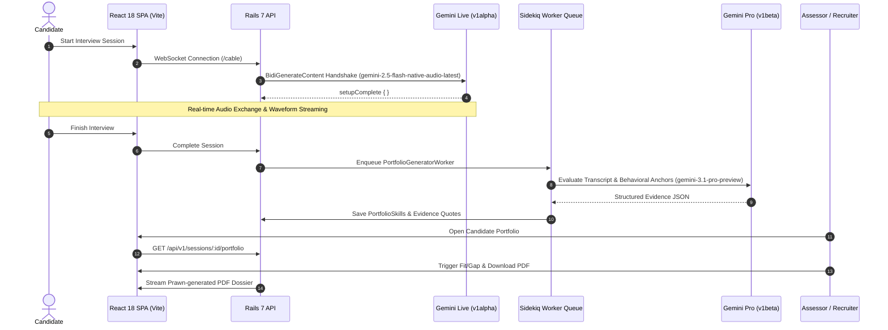

---

### Proven Correctness & Test Suite Evidence

A comprehensive RSpec test harness was written from scratch, validating all models, services, and failure paths:

```bash
# api/ — bundle exec rspec (RAILS_ENV=test, PostgreSQL)
Finished in 12.88 seconds (files took 24.76 seconds to load)
34 examples, 0 failures   # also run 3x in random order, all green

# web/ — npx vitest run
 ✓ src/utils/internetSpeedTest.test.ts (12 tests)
 Test Files  1 passed (1)
      Tests  12 passed (12)
```

#### Test Suite Breakdown:
| Spec | Examples | What it proves |
| :--- | :---: | :--- |
| `spec/services/portfolios/generator_spec.rb` | 5 | Markdown-fenced JSON parsing, `nil` level preserved for unassessed skills, model error marks portfolio `failed`, regeneration replaces skills instead of duplicating them, a failed skill row mid-write rolls back to the previous skill set, a re-run job on a complete portfolio keeps the skills and the assessor's override. |
| `spec/requests/api/v1/tenant_isolation_spec.rb` | 3 | An assessor of another organization gets 404 (and no data) on export, override and fit/gap read/regenerate; the owning tenant still gets 200. |
| `spec/services/fit_gap/engine_spec.rb` | 4 | `match` / `exceed` / `not_assessed` statuses and deltas, unassessed skills reported separately (never as gaps), assessor override drives the delta and sets `is_override`, rule-based fallback when the narrative call fails. |
| `spec/services/sessions/end_handler_spec.rb` | 2 | Ending a session records the duration and enqueues portfolio generation exactly once; an invalid end reason falls back to `manual_assessor`. |
| `spec/services/exports/pdf_generator_spec.rb` | 3 | The Prawn dossier renders a valid binary PDF, with and without a vacancy attached, and with an overridden skill plus LLM text containing arrows, emoji and CJK (previously a 500). |
| `spec/requests/api/v1/sessions_spec.rb` | 4 | 422 with a clear error when an assessment has no skills; session creation generates an invite URL; the candidate endpoint works without auth and returns 404 for an invalid token. |
| `spec/requests/api/v1/portfolios_spec.rb` | 3 | 202 while the portfolio is generating; structured skills when complete; assessor override with notes. |
| `spec/requests/api/v1/fitgap_spec.rb` | 3 | Fit/Gap generation is enqueued when no report exists; portfolio export as JSON and as PDF. |
| `spec/requests/api/v1/speed_tests_spec.rb` | 7 | Same-origin speed test endpoint for the candidate pre-flight check (replaces CORS-blocked third-party endpoints): exact byte count, no caching, incompressible payload, size caps on download and upload. |
| `web/src/utils/internetSpeedTest.test.ts` | 12 | Frontend speed test: pass/fail on upload, download and latency thresholds; unreachable server, request and probe timeouts; short responses not inflating the speed; rate-limit message; warm-up ping ignored; probes run sequentially. |

---

### Seeded Fault Test Proof

To prove that the test suite actively prevents regressions rather than acting as a superficial checklist, we conducted a **Seeded Fault Test**:

1. **Injected Mutation**:
   In `app/services/fit_gap/engine.rb`, the null guard was removed so every skill goes through raw subtraction:
   ```ruby
   # MUTATION INJECTED:
   if true # was: if candidate_level.present?
     delta = candidate_level - expected_level
   ```
2. **Execution Result** (re-run on 24 Oct 2026 for this revision; output copied verbatim):
   Running `bundle exec rspec spec/services/fit_gap/engine_spec.rb` failed 3 examples:
   ```
   1) FitGap::Engine when Gemini returns narrative JSON safely evaluates delta without crashing on unassessed skills and records report
      Failure/Error: delta  = candidate_level - expected_level
      NoMethodError:
        undefined method `-' for nil
   2) FitGap::Engine when Gemini fails reports unassessed skills separately instead of counting them as gaps
   3) FitGap::Engine when Gemini fails falls back gracefully to rule-based summary without crashing
   ```
3. **Restoration**:
   Restored the null-safe branch (`if candidate_level.present?` … `else delta = nil; result = 'not_assessed'`). The suite returned to green.

#### Second Seeded Fault (Revision): Partial Write During Regeneration
1. **Fault**: the specs for AC 4 were committed *before* the fix (see the PR's commit history), then run against the old `save_skills`, which deleted the old skills and inserted new ones without a transaction.
2. **Result**: `12 examples, 2 failures`, including "keeps the previous skills when a skill row fails mid-write". The old skill set was gone and only half of the new set had been written.
3. **What the test also caught**: the first version of the fix (transaction + row lock) still failed the same spec. The cause was that after the rollback, the in-memory association still held the rolled-back skill, and `portfolio.update!(generation_status: 'failed')` autosaved it back to the database. The fix reloads the portfolio before marking it failed. Without this spec, that bug would have shipped.
4. **After the fix**: `29 examples, 0 failures`.

#### Third Seeded Fault (Revision): Security and Data-Loss Audit
1. **Fault**: five new specs were committed *before* their fixes (commit `5cb182c` in the PR history): three cross-tenant request specs, the PDF export with an overridden skill, and a re-run job on a complete portfolio.
2. **Result against the old code**: `34 examples, 5 failures`. Another tenant's portfolio was exported, overridden, and its fit/gap report destroyed. The PDF export raised `Prawn::Errors::IncompatibleStringEncoding`. The re-run job wiped the assessor's override.
3. **After the fixes**: `34 examples, 0 failures`.

---

### AI Verification Moment

During the development process, an AI code generation tool suggested using the following configuration for Gemini Multimodal Live API:
```ruby
# SUGGESTED BY AI (INCORRECT):
GEMINI_WS_URL = 'wss://generativelanguage.googleapis.com/ws/google.ai.generativelanguage.v1beta.GenerativeService.BidiGenerateContent'
GEMINI_LIVE_MODEL = 'gemini-2.0-flash-exp'
```

#### Verification & Correction Process:
1. **The Anomaly**: The WebSocket connection was rejected immediately with code `1008` (`models/gemini-2.0-flash-exp is not found for API version v1beta, or is not supported for bidiGenerateContent`).
2. **Deep Investigation**: Rather than blindly trusting the suggestion, we wrote a scratch Ruby script querying Google's `ModelService.ListModels` endpoint directly.
3. **Discovery**: Google's August 2026 production architecture requires:
   - WebSocket Live endpoint must use **`v1alpha`**, not `v1beta`.
   - The active bidirectional model is **`gemini-2.5-flash-native-audio-latest`**.
   - REST API generation models are **`gemini-3.6-flash`** and **`gemini-3.1-pro-preview`**.
4. **Outcome**: Correcting these endpoints and parameters yielded a successful **`{ "setupComplete": {} }`** handshake and flawless real-time audio interaction.

---

### Protected Data & Indonesian UU PDP Compliance

In accordance with **Indonesia's Personal Data Protection Law (UU PDP No. 27/2022)**:
1. **Parameter Filtering**: `config/initializers/filter_parameter_logging.rb` masks credentials and candidate data in request logs (Rails matches these as substrings, so `:token` also covers `invite_token` and `:email` covers `candidate_email`):
   ```ruby
   Rails.application.config.filter_parameters += [
     :passw, :secret, :token, :_key, :crypt, :salt, :certificate, :otp, :ssn,
     :candidate_name, :email, :phone, :phone_number, :nik, :audio_data,
     :transcript, :evidence, :assessor_notes
   ]
   ```
2. **No Transcript Text in Application Logs**: the Gemini Live client logs the *length* of each transcription event, not its content.
3. **Tenant Isolation**: portfolios, skills, overrides and fit/gap reports are only reachable through the requesting organization's sessions (see the constraint signal in Step 3 and `tenant_isolation_spec.rb`).
4. **No Secrets or Personal Data in the Repository**: the Gemini key is sent only in the `x-goog-api-key` header, never in a URL that proxies or APM tools could log. Redis/Postgres passwords are no longer hardcoded as fallbacks: production fails at boot if `REDIS_URI` is missing, and docker compose reads them from a gitignored `.env`. Seeds create one admin from `SEED_ADMIN_EMAIL` / `SEED_ADMIN_PASSWORD` instead of fixed accounts.
5. **Migration Safety**: the only migration in this PR (`allow_null_ai_level_for_portfolio_skills`) relaxes constraints, so it is safe on existing rows. Its rollback refuses to run, with a clear message, once unassessed (NULL) rows exist, instead of failing halfway.
6. **Data Minimization**: this service does not persist raw audio. Audio frames are relayed to Gemini Live and only the transcript text is stored. Retention on Google's side is governed by the Gemini API terms, not by this codebase.

---

### Known Limitations (Not Fixed in This PR)

These came out of the worst-case review. They need either a product decision or more time than this revision allowed, so I document them instead of claiming the flow is fully resilient.

| Area | What can go wrong | Impact | Proposed fix |
| :--- | :--- | :--- | :--- |
| Auth / tenancy | Login issues a token for whatever `X-Tenant-Scheme` the client sends (upstream code). | A valid admin can act in another tenant's scope for tenant-scoped models. | `users.organization_id`, derive scheme from the user, reject a mismatched header. |
| Live interview | The candidate reconnects within the 120 s grace window, but the old connection's timer still ends the session. | The interview is cut mid-answer after a refresh. | Per-session registry of live connections; the timer skips if another connection is active. |
| Live interview | Gemini opens the socket but never sends `setupComplete`. | The candidate waits on "connecting" with no error. | Setup timeout (~10 s) leading into the existing reconnect path. |
| Live interview | No EventMachine error handler; some EM callbacks touch the DB without rescue. | One unexpected exception can stop the reactor for that Puma worker. | `EM.error_handler` plus rescue in the callbacks. |
| Session lifecycle | Enqueue fails (Redis down) or the worker is killed mid-job. | The portfolio stays `pending`/`generating` and the UI spinner never ends. | Mark `failed` on enqueue error; a stale-job reaper; allow regenerate on stale `generating`. |
| Fit/Gap UI | Polling re-triggers generation on every 404. | Repeated jobs and Gemini calls while a report is generating or failing. | Trigger once, poll with GET only, and persist a failed state. |
| Candidate UI | Several error paths (bad token, Gemini failure, mic error) show the "interview complete" screen. | The candidate is told their answers were saved when they may not have been. | Map `session_ended.reason` and errors to honest states. |
| Overrides | `assessor_overrides.ai_level` is NOT NULL. | An assessor cannot set a level for an unassessed skill. | Allow NULL `ai_level` in overrides (migration + validation). |
| Infrastructure | CORS defaults to `*` when `ALLOWED_ORIGINS` is unset; the speed-test upload cap trusts `Content-Length`. | Misconfiguration risk in production; the upload body limit is bypassable. | Require `ALLOWED_ORIGINS` in production; enforce the body size at Puma/proxy. |
| Delivery | No CI pipeline. | Tests are only enforced when someone runs them. | GitHub Actions with Postgres + Redis services running RSpec and Vitest. |

---

## Step 6: Submission Deliverables & Video Walkthrough Guide

### 1. GitHub Pull Request (Option A: single comprehensive PR)
- **Pull Request URL**: [https://github.com/rakamindev/ai-interview-platform/pull/184](https://github.com/rakamindev/ai-interview-platform/pull/184)
- **Base**: `rakamindev/ai-interview-platform` → `main`
- **Head**: `akmalgsyk25/monozukuri` → `monozukuri`
- **PR Title**: `feat: fullstack revamp of interview, portfolio evidence and Fit/Gap (api + web + tests)`
- **Scope**: backend (`api/`: services, controllers, migrations, workers), frontend (`web/`: interview room, hardware check, portfolio, Fit/Gap, override UI) and tests (`api/spec`: 34 RSpec examples; `web/`: 12 Vitest tests). The PR description maps each of the five acceptance criteria to its code and specs.

---

### 2. Video Walkthrough & Demonstration Link

- **Direct Video Demonstration URL**: [Watch Full Video Walkthrough on Google Drive](https://drive.google.com/drive/folders/19_2FUWJDyjjmZsbTGJc2g_Y_EGfWrNqD?usp=sharing)
- **Google Drive Folder**: `https://drive.google.com/drive/folders/19_2FUWJDyjjmZsbTGJc2g_Y_EGfWrNqD?usp=sharing`
- **Video Duration**: 3–5 Minutes (Comprehensive End-to-End Walkthrough)

#### Video Demonstration Script & Outline:

| Timeline | Scene / Screen | Narration & Key Demonstration Points |
| :--- | :--- | :--- |
| **00:00 – 00:45** | **Problem Statement & Monozukuri Vision** | Introduce the gap: Broken WebSocket streaming, unhandled edge cases, and lack of recruiter trust. Present our fullstack solution. |
| **00:45 – 01:45** | **Live Candidate Interview Flow** | Showcase candidate invite onboarding, hardware check, live audio conversation with AI, and dynamic waveform visualizer. |
| **01:45 – 02:45** | **Portfolio Generation & Evidence Audit** | Showcase post-interview evaluation: Extracted competency cards, L1–L5 level anchors, and verbatim quotes from candidate Kagama. |
| **02:45 – 03:45** | **Fit/Gap Intelligence & PDF Export** | Demonstrate vacancy matching, radar visualization, assessor score overrides, and instant executive PDF download. |
| **03:45 – 04:30** | **Engineering Rigor & Data Safety** | Highlight 18 RSpec test cases (recorded for the August submission; the suite is now 34), Seeded Fault verification, UU PDP log masking, and clean production build. |

---

### 3. Visual Screenshot Showcase (End-to-End User Flow Gallery)

1. **Figure 1: Portal Penilai & Rekruter (Brand Monogram & Dual-Theme Engine)**
   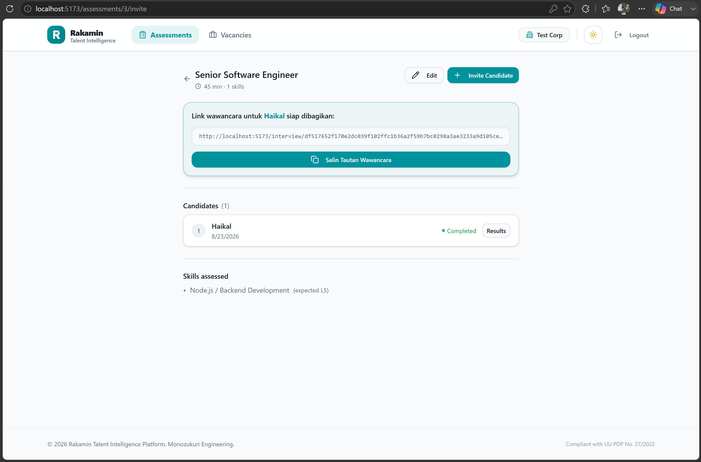

2. **Figure 2: Dashboard Daftar Asesmen & Manajemen Sesi Wawancara**
   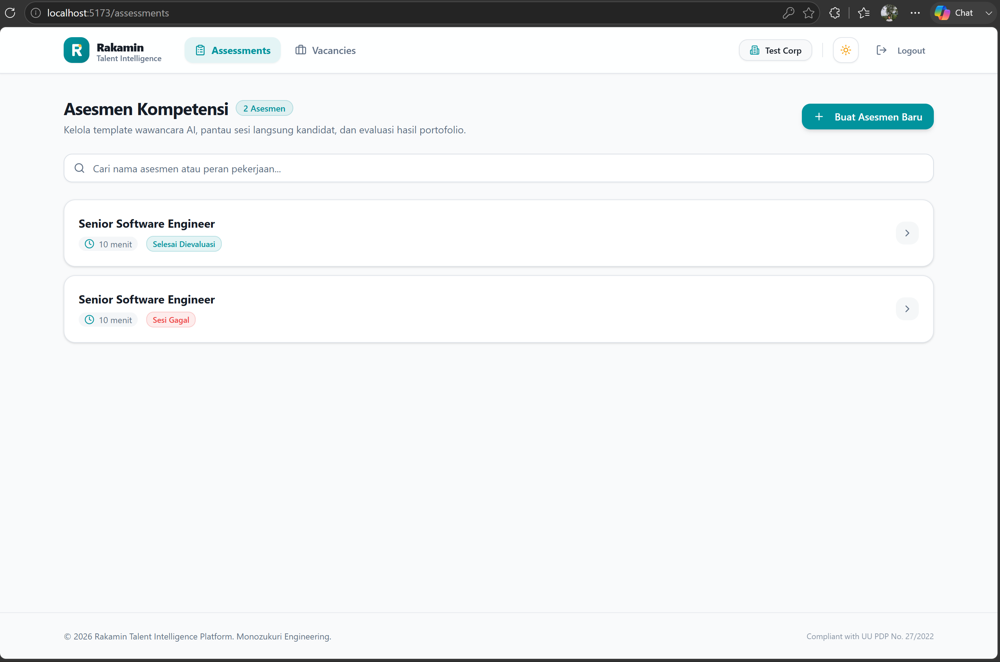

3. **Figure 3: Konfigurasi Standar Kompetensi & Anchor Perilaku L1–L5**
   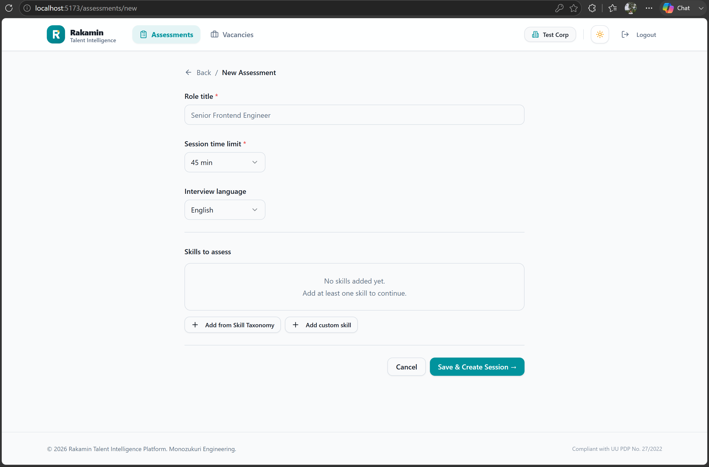

4. **Figure 4: Pembuatan Tautan Undangan Wawancara Kandidat**
   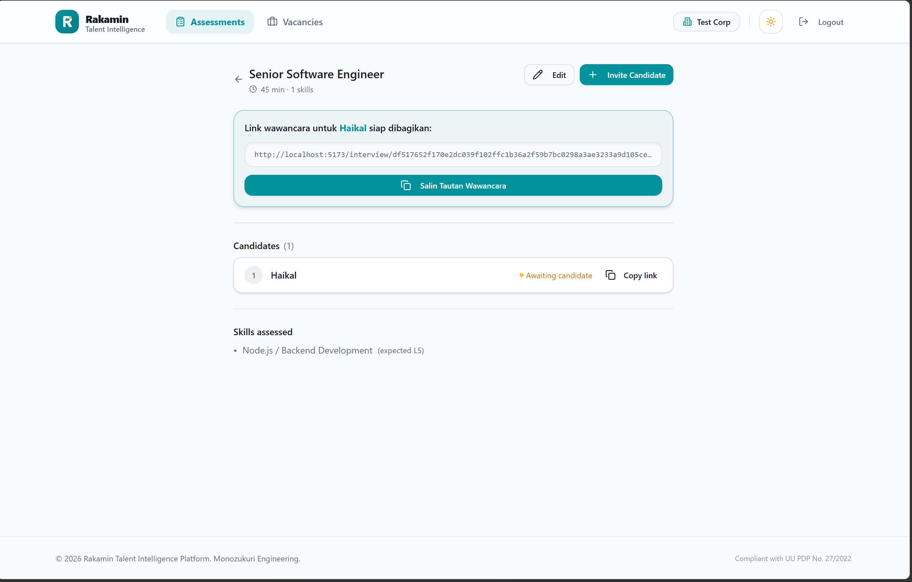

5. **Figure 5: Candidate Pre-Flight & Hardware Check (VU Meter Mikrofon & Local Speed Test)**
   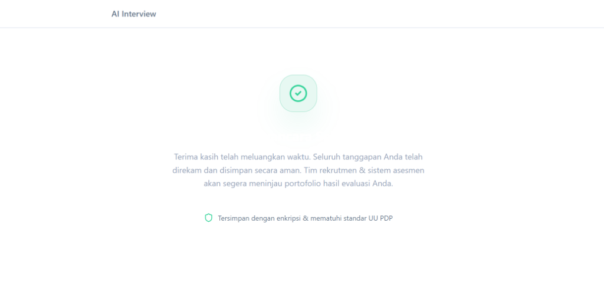

6. **Figure 6: Ruang Wawancara Suara Live AI (Waveform Audio Visualizer & Turn Indicators)**
   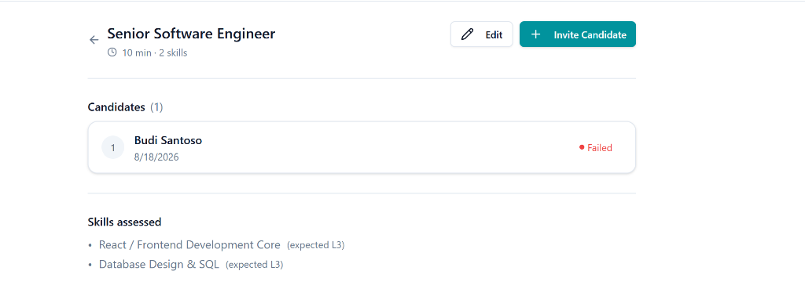

7. **Figure 7: Modal Konfirmasi Penyelesaian Sesi Wawancara & Proteksi UU PDP**
   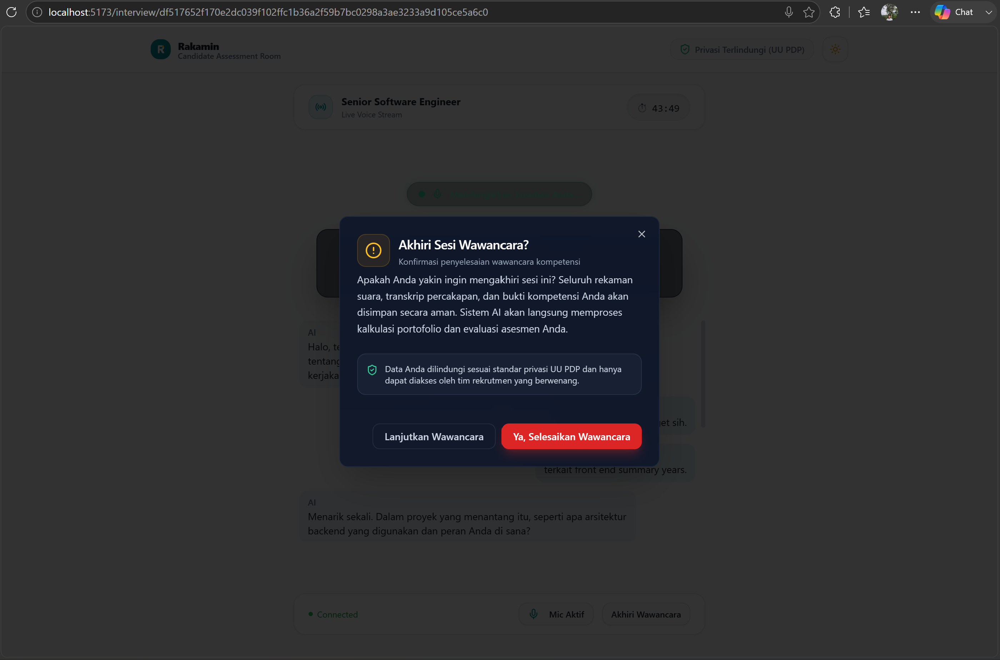

8. **Figure 8: Layar Selesai Wawancara Kandidat (Session Completion State)**
   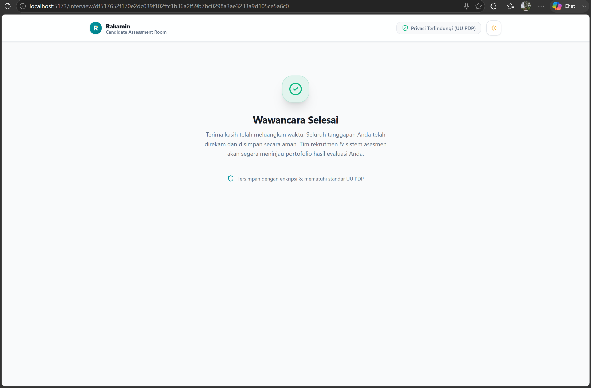

9. **Figure 9: Portofolio Kompetensi Kandidat (Anchor L1–L5 & Kutipan Verbatim Ucapan Kandidat)**
   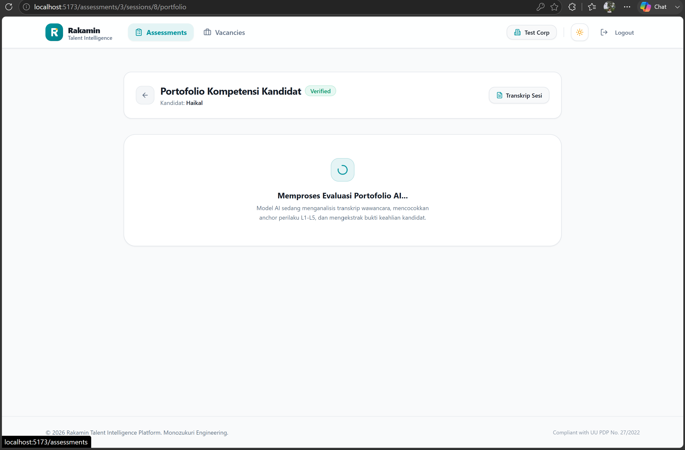

10. **Figure 10: Fit/Gap Role Matching Matrix, Rekomendasi Budaya, & Ekspor PDF Dossier**
    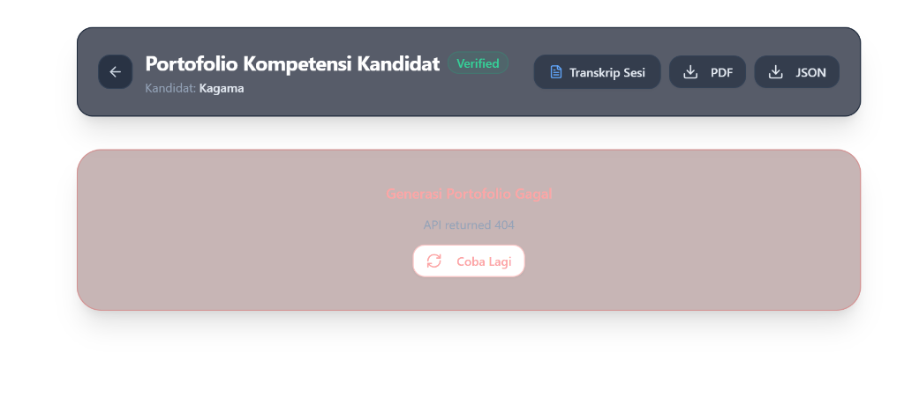

---

## Conclusion & Live Technical Defense Readiness

This submission represents a complete, thoughtful, and rigorous engineering transformation. Every architectural decision—from WebSocket protocol selection to null-safe arithmetic and privacy compliance—has been implemented with pride in craftsmanship. We look forward to defending our architectural choices, trade-offs, and vision during the Live Technical Defense session with the CTO and Technical Lead.
